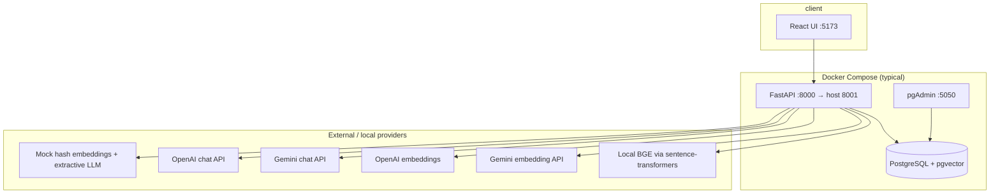

# Architecture — Mini Knowledge Assistant

## Overview

Vertical slice: ingest plain-text articles, chunk and embed into Postgres (pgvector), answer questions with retrieval-augmented generation (RAG), return cited sources. Optional **pgAdmin** container browses the same tables as the API.

**Default host ports:** API **8001**, UI **5173**, Postgres **5433** (avoids clash with a local Windows PostgreSQL on 5432), pgAdmin **5050**.

## HTTP surface

| Method | Path | Role |
| --- | --- | --- |
| `POST` | `/documents` | Create document, chunk, embed, store |
| `GET` | `/documents` | Paginated list (`limit`, `offset`; newest first) |
| `POST` | `/documents/reindex` | Re-chunk and re-embed all documents (after embedding/chunk config change) |
| `POST` | `/ask` | RAG: embed question → retrieve → generate (rate limited) |
| `GET` | `/health` | `status: ok` and configured `mode` (does not call LLM) |

Swagger: `/docs`. Errors use a stable JSON shape with `request_id` (see `app/errors.py`).

## Data model

| Table | Purpose |
| --- | --- |
| `documents` | Article metadata and full text (`id`, `title`, `content`, `created_at`) |
| `chunks` | Retrieval units: `document_id`, `chunk_index`, `text`, `embedding vector(N)`; FK cascade delete |
| `questions` | Ask audit log: `question`, `answer`, `source_chunk_ids[]`, `latency_ms` (end-to-end ms for that ask), `created_at` |

**Indexing:** On startup, `init_db` enables `vector`, runs `create_all`, and creates HNSW on `chunks.embedding` with `vector_cosine_ops`. Retrieval uses cosine distance; score ≈ `1 - distance`, filtered by `MIN_RELEVANCE_SCORE`.

**Chunk text:** Each chunk is prefixed with `Title: …` during indexing (`services/indexing.py`) so title terms participate in search.

**Vector dimension:** Must match `EMBEDDING_DIM` (384 for BGE-small, 768 for Gemini API embeddings, 1536 for OpenAI). Changing dimension requires resetting the DB volume or migrating the column.

## Request flows

### Ingest (`POST /documents`)

1. Validate title/content length (Pydantic + settings caps).
2. Split content (`chunking.py`: size/overlap from env).
3. Prefix chunks with title (`indexing.py`).
4. Embed all pieces via current `EmbeddingProvider`.
5. Insert `documents` row + `chunks` rows in one transaction.

### Reindex (`POST /documents/reindex`)

For each document: delete existing chunks, re-split, re-embed, insert new chunks. Does not alter `documents` body text. Required when `EMBED_MODEL`, provider, or chunk settings change without re-uploading articles.

### Ask (`POST /ask`)

1. Rate limit (sliding window per IP or `X-API-Key`).
2. Embed question.
3. Top-k vector search + minimum score threshold.
4. If no chunks pass threshold → fixed “not found” message, **no LLM call**, still log `questions`.
5. Else → LLM with delimited context blocks (prompt treats context as data, not instructions).
6. Return answer, sources (id, title, chunk_index, snippet, score), and `mode`; persist `questions` with `latency_ms`.

## Service boundaries

| Layer | Location | Responsibility |
| --- | --- | --- |
| API | `app/api/*` | HTTP, validation, rate limit on `/ask` |
| Persistence | `app/db.py`, `app/models.py` | Async SQLAlchemy + asyncpg, pooling |
| Config | `app/config.py` | `pydantic-settings`; `LLM_PROVIDER=google` → Gemini; model alias map for retired IDs |
| Chunking | `services/chunking.py` | Paragraph/sentence-aware splits |
| Indexing | `services/indexing.py` | Title-prefixed chunk strings |
| Embeddings | `services/embeddings.py` | Provider selection (see below) |
| Local embed | `services/local_embeddings.py` | `sentence-transformers` in thread pool executor |
| Gemini HTTP | `services/gemini_client.py` | Shared client for Gemini embed + chat |
| Retrieval | `services/retrieval.py` | pgvector cosine top-k |
| LLM | `services/llm.py` | Mock / OpenAI / Gemini grounded generation |
| RAG | `services/rag.py` | Orchestration |

Providers are built in `build_embedding_provider` / `build_llm_provider` and injected via FastAPI dependencies (`app/dependencies.py`, cached per process) so tests override without real API calls.

## Provider matrix

| Concern | Env knobs | Implementations |
| --- | --- | --- |
| **LLM (answers)** | `LLM_PROVIDER`, `GOOGLE_API_KEY` / `GEMINI_API_KEY`, `LLM_MODEL` | `MockLLMProvider`, `OpenAILLMProvider`, `GeminiLLMProvider` |
| **Embeddings (search)** | `EMBED_MODEL` (optional), `PROVIDER` / `LLM_PROVIDER`, keys | **Priority:** if `EMBED_MODEL` set → `LocalEmbeddingProvider` (BGE in Docker image); on missing local runtime + Gemini key → fallback to Gemini embeddings; else mock / OpenAI / Gemini by provider name |

**Health / response `mode`:** Reflects configuration (`google`, `mock`, `openai`, `gemini`, `local`), not a live provider ping. `/health` returns `mode`; `/ask` includes `mode` in the body.

**Recommended stack:** `LLM_PROVIDER=google` + `GOOGLE_API_KEY` for chat, `EMBED_MODEL=BAAI/bge-small-en-v1.5` + `EMBEDDING_DIM=384` for local search (Dockerfile pre-installs BGE).

## Frontend

React (Vite) + TypeScript, no heavy UI library. Calls API via `VITE_API_URL` (Docker build defaults to host API port 8001). Components handle loading, empty, success, errors (including 429 countdown). Sources shown as ranked cards with score and snippet.

## Async behaviour

- **Database:** `asyncpg` + `AsyncSession`; handlers avoid blocking drivers.
- **Upstream:** `httpx.AsyncClient` with timeouts; retries with exponential backoff + jitter on timeouts/5xx; upstream 429 surfaced with `Retry-After` (no unbounded retry loops).
- **CPU:** Local BGE runs in `asyncio` executor so the event loop is not blocked.

## Deployment layout (Docker Compose)

| Service | Image / build | Notes |
| --- | --- | --- |
| `db` | `pgvector/pgvector:pg16` | Credentials `kb`/`kb`, DB `kb`; host port `${DB_HOST_PORT:-5433}` |
| `pgadmin` | `dpage/pgadmin4` | Browser UI; connect to host `db:5432` inside network |
| `backend` | `backend/Dockerfile` | `DATABASE_URL` → `db:5432`; optional `.env` via `env_file` |
| `frontend` | `frontend/Dockerfile` + nginx | Static build; API URL baked at build arg |

Backend bind-mounts `./backend/app` read-only for live code edits without rebuild (not for dependency changes).

## Operational concerns

- **Secrets:** Environment only; never logged or returned in error JSON.
- **Logging:** Request middleware logs method, path, status, `latency_ms`, `request_id`.
- **CORS:** `CORS_ORIGINS` for UI origins.
- **Monitoring (future):** Ask latency histograms, retrieval empty-rate, LLM errors, rate-limit hits, pool saturation.

## Failure behaviour

| Failure | User sees | Notes |
| --- | --- | --- |
| Invalid input | `422` + validation message | No internal details |
| Rate limit | `429` + `Retry-After` | Per IP or `X-API-Key` |
| DB down | `503` service unavailable | Logged server-side |
| LLM/embedding timeout | `504` | After retries exhausted |
| Upstream 5xx | `502` | After retries |
| Upstream 429 | `503` + `Retry-After` | Provider limit honoured |
| No relevant chunks | `200` safe “not found” answer | LLM not called |

## Rate limiting

In-memory sliding window (`app/rate_limit.py`) keyed by `X-API-Key` or client IP — suitable for single instance. For horizontal scale, replace with Redis-backed limiter behind the same interface.

## Scalability discussion

| Scale | First bottleneck | Evolution |
| --- | --- | --- |
| **10K concurrent** | LLM latency/quota, DB pool | Async I/O, timeouts, pool tuning, multiple workers, semaphore around LLM |
| **100K concurrent** | Single-node limits, in-memory rate limits | Load balancer, Redis rate limit + cache, queue ingestion, observability |
| **1M concurrent** | Provider quota, vector throughput | Split API vs workers, vector replicas, multi-region, degradation (retrieval-only / cached answers) |

**Assumptions to measure:** p50/p95 LLM latency, tokens per request, corpus size, cache hit rate, read/write ratio, index recall vs latency, provider rate limits.

## Testing

`pytest` + `pytest-asyncio` under `backend/tests/`. Uses mock provider by default; requires Postgres (Docker `db` on host port **5433** when using default compose mapping). No tests call live OpenAI or Gemini.

## Assumptions (this submission)

- Single tenant, no auth (client id = IP or optional `X-API-Key`).
- Documents are plain text stored in Postgres (UI may accept markdown as text).
- Mock mode is demo-only; exposed via `/health` and ask `mode`.
- Gemini model IDs may be aliased in config when Google retires older names.

## Related docs

- [README.md](./README.md) — setup, pgAdmin, troubleshooting, API examples
- [AI_USAGE.md](./AI_USAGE.md) — AI-assisted development disclosure
