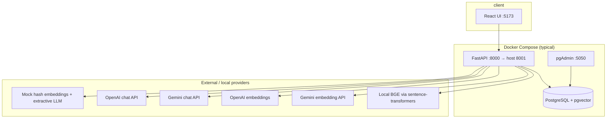

# Architecture — Mini Knowledge Assistant

## Overview

Vertical slice: ingest plain-text articles, chunk and embed into Postgres (pgvector), answer questions with retrieval-augmented generation (RAG), return cited sources. Optional **pgAdmin** container browses the same tables as the API.

**Default host ports:** API **8001**, UI **5173**, Postgres **5433** (avoids clash with a local Windows PostgreSQL on 5432), pgAdmin **5050**.

## HTTP surface

| Method | Path | Role |
| --- | --- | --- |
| `POST` | `/documents` | Create document, chunk, embed, store |
| `GET` | `/documents` | Paginated list (`limit`, `offset`; newest first) |
| `POST` | `/documents/reindex` | Re-chunk and re-embed all documents (after embedding/chunk config change); **no auth** in demo |
| `POST` | `/ask` | RAG: embed question → retrieve → generate (rate limited) |
| `GET` | `/health` | `status: ok` and configured `mode` (does not call LLM) |

Swagger: `/docs`. Errors use a stable JSON shape with `request_id` (see `app/errors.py`).

## Data model

| Table | Purpose |
| --- | --- |
| `documents` | Article metadata and full text (`id`, `title`, `content`, `created_at`) |
| `chunks` | Retrieval units: `document_id`, `chunk_index`, `text`, `embedding vector(N)`; FK cascade delete |
| `questions` | Ask audit log: `question`, `answer`, `source_chunk_ids[]`, `latency_ms` (end-to-end ms for that ask), `created_at` |

**Indexing:** On startup, `init_db` enables `vector`, runs `create_all`, and creates HNSW on `chunks.embedding` with `vector_cosine_ops`. Retrieval uses cosine distance; score ≈ `1 - distance`, filtered by `MIN_RELEVANCE_SCORE`. HNSW in pgvector fits small-to-medium corpora; index build time and memory grow with chunk count — at very high QPS or huge indexes, a dedicated vector tier or partitioning becomes a **future** option (see scalability below).

**Chunk text:** Each chunk is prefixed with `Title: …` during indexing (`services/indexing.py`) so title terms participate in search.

**Vector dimension:** Must match `EMBEDDING_DIM` (384 for BGE-small, 768 for Gemini API embeddings, 1536 for OpenAI). Changing dimension requires resetting the DB volume or migrating the column.

## Request flows

### Ingest (`POST /documents`)

1. Validate title/content length (Pydantic + settings caps).
2. Split content (`chunking.py`: size/overlap from env).
3. Prefix chunks with title (`indexing.py`).
4. Embed all pieces via current `EmbeddingProvider`.
5. Insert `documents` row + `chunks` rows in one transaction.

### Reindex (`POST /documents/reindex`) — **current**

For each document: delete existing chunks, re-split, re-embed, insert new chunks. Does not alter `documents` body text. Required when `EMBED_MODEL`, provider, or chunk settings change without re-uploading articles. Runs **synchronously in one HTTP request** — fine for demos; large corpora need the **future** job-based design below.

### Ask (`POST /ask`)

1. Rate limit (sliding window per IP or `X-API-Key`).
2. Embed question.
3. Top-k vector search + minimum score threshold.
4. If no chunks pass threshold → fixed “not found” message, **no LLM call**, still log `questions`.
5. Else → LLM with delimited context blocks (prompt treats context as data, not instructions).
6. Return answer, sources (id, title, chunk_index, snippet, score), and `mode`; persist `questions` with `latency_ms`.

## Service boundaries

| Layer | Location | Responsibility |
| --- | --- | --- |
| API | `app/api/*` | HTTP, validation, rate limit on `/ask` |
| Persistence | `app/db.py`, `app/models.py` | Async SQLAlchemy + asyncpg, pooling |
| Config | `app/config.py` | `pydantic-settings`; `LLM_PROVIDER=google` → Gemini; model alias map for retired IDs |
| Chunking | `services/chunking.py` | Paragraph/sentence-aware splits |
| Indexing | `services/indexing.py` | Title-prefixed chunk strings |
| Embeddings | `services/embeddings.py` | Provider selection (see below) |
| Local embed | `services/local_embeddings.py` | `sentence-transformers` in thread pool executor |
| Gemini HTTP | `services/gemini_client.py` | Shared client for Gemini embed + chat |
| Retrieval | `services/retrieval.py` | pgvector cosine top-k |
| LLM | `services/llm.py` | Mock / OpenAI / Gemini grounded generation |
| RAG | `services/rag.py` | Orchestration |

Providers are built in `build_embedding_provider` / `build_llm_provider` and injected via FastAPI dependencies (`app/dependencies.py`, cached per process) so tests override without real API calls.

## Provider matrix

| Concern | Env knobs | Implementations |
| --- | --- | --- |
| **LLM (answers)** | `LLM_PROVIDER`, `GOOGLE_API_KEY` / `GEMINI_API_KEY`, `LLM_MODEL` | `MockLLMProvider`, `OpenAILLMProvider`, `GeminiLLMProvider` |
| **Embeddings (search)** | `EMBED_MODEL` (optional), `PROVIDER` / `LLM_PROVIDER`, keys | **Priority:** if `EMBED_MODEL` set → `LocalEmbeddingProvider` (BGE in Docker image); on missing local runtime + Gemini key → fallback to Gemini embeddings; else mock / OpenAI / Gemini by provider name |

**Health / response `mode`:** Reflects configuration (`google`, `mock`, `openai`, `gemini`, `local`), not a live provider ping. `/health` returns `mode`; `/ask` includes `mode` in the body.

**Recommended stack:** `LLM_PROVIDER=google` + `GOOGLE_API_KEY` for chat, `EMBED_MODEL=BAAI/bge-small-en-v1.5` + `EMBEDDING_DIM=384` for local search (Dockerfile pre-installs BGE).

## Frontend

React (Vite) + TypeScript, no heavy UI library. Calls API via `VITE_API_URL` (Docker build defaults to host API port 8001). Components handle loading, empty, success, errors (including 429 countdown). Sources shown as ranked cards with score and snippet.

## Async behaviour (**current**)

- **Database:** `asyncpg` + `AsyncSession`; handlers avoid blocking drivers.
- **Upstream:** `httpx.AsyncClient` with `UPSTREAM_TIMEOUT_SECONDS`; retries with exponential backoff + jitter on timeouts/5xx; upstream 429 surfaced with `Retry-After` (no unbounded retry loops).
- **CPU:** Local BGE runs in a thread-pool executor (`local_embeddings.py`) so the event loop is not blocked — but embedding is still **in-process** and CPU-bound; worker and executor sizing must be tuned together under load (**future:** dedicated embedding service).
- **Gap at scale:** A hard deadline on the full `/ask` handler (so slow upstreams cannot hold connections indefinitely) and per-client connection limits on shared `httpx` clients are **recommended evolutions**, not fully enforced today.

## Deployment layout (Docker Compose)

| Service | Image / build | Notes |
| --- | --- | --- |
| `db` | `pgvector/pgvector:pg16` | Credentials `kb`/`kb`, DB `kb`; host port `${DB_HOST_PORT:-5433}` |
| `pgadmin` | `dpage/pgadmin4` | Browser UI; connect to host `db:5432` inside network |
| `backend` | `backend/Dockerfile` | `DATABASE_URL` → `db:5432`; optional `.env` via `env_file` |
| `frontend` | `frontend/Dockerfile` + nginx | Static build; API URL baked at build arg |

Backend bind-mounts `./backend/app` read-only for **local dev only** — convenient for code edits without rebuild; not used in production-style deploys (dependency changes still require image rebuild).

## Operational concerns

- **Secrets:** Environment only; never logged or returned in error JSON.
- **Logging:** Request middleware logs method, path, status, `latency_ms`, `request_id`.
- **CORS:** `CORS_ORIGINS` for UI origins.
- **Monitoring (future):** Ask latency histograms, retrieval empty-rate, LLM errors, rate-limit hits, pool saturation.

## Failure behaviour

| Failure | User sees | Notes |
| --- | --- | --- |
| Invalid input | `422` + validation message | No internal details |
| Rate limit | `429` + `Retry-After` | Per IP or `X-API-Key` |
| DB down | `503` service unavailable | Logged server-side |
| LLM/embedding timeout | `504` | After retries exhausted |
| Upstream 5xx | `502` | After retries |
| Upstream 429 | `503` + `Retry-After` | Provider limit honoured |
| No relevant chunks | `200` safe “not found” answer | LLM not called |

## Rate limiting and `Retry-After`

### **Current** (`app/rate_limit.py`)

- In-memory sliding window per `X-API-Key` or client IP on `POST /ask` only (`RATE_LIMIT_PER_MINUTE`, default 20).
- On limit: HTTP **429** with **`Retry-After`** (seconds until the oldest event in the window expires, rounded up).
- Correct for **one API instance**; each replica maintains its own counters.

### **Future** (multi-instance)

- **Shared limiter:** Redis sorted set per client (timestamps as scores); trim, count, and insert in one Lua script for atomicity. Same interface as today’s limiter. Token bucket is an alternative for controlled bursts.
- **Upstream LLM 429:** Honour provider `Retry-After`; do not tight-loop retries. Surface **503** + `Retry-After` to clients; briefly tighten LLM semaphore or open a circuit breaker so load does not pile onto a throttled provider.

---

## Scalability evolution

The table summarizes direction; subsections mix **what exists today** with **proposed** changes. Items marked *future* are not implemented in this repo.

| Scale | First bottleneck |
| --- | --- |
| **~10K concurrent** | LLM latency and quota; then DB pool and in-process BGE |
| **~100K concurrent** | Single-node capacity, per-instance rate limits, provider quota |
| **~1M concurrent** | Provider quota/cost, vector throughput, operational complexity |

### ~10K concurrent

**First bottleneck:** LLM latency and quota, then the DB pool and the local BGE embedding step.

**Build on current design:**

- **Async I/O and timeouts:** Already uses asyncpg and httpx. *Evolve:* explicit connect/read/total timeouts on every outbound call; overall `/ask` deadline so slow upstreams cannot hold connections indefinitely.
- **Connection pooling:** Size SQLAlchemy pool per worker so `workers × (pool_size + max_overflow) < Postgres max_connections`. *Future:* PgBouncer (transaction mode) if workers outgrow that. Reuse one `httpx.AsyncClient` per process with limits on keep-alive and max connections.
- **Workers:** Multiple uvicorn workers (gunicorn or `--workers`) sized to CPU. BGE in a thread pool is CPU-bound — tune worker count and executor threads together to avoid oversubscription.
- **LLM path:** *Future:* `asyncio.Semaphore` on LLM calls below provider limits; circuit breaker after repeated 5xx/timeouts; keep bounded retries with jitter (already present on embed/LLM HTTP).
- **Retrieval-only shortcut (**current**):** No relevant chunks → no LLM call (`rag.py`). Monitor this path as a cost/latency metric.

### ~100K concurrent

**First bottleneck:** Single-node limits, in-memory rate limiting (each instance has its own counters), and provider quota.

**Future / ops:**

- **Horizontal scaling:** Stateless API instances behind a load balancer; health checks on `/health`; graceful shutdown. Postgres read replicas for vector search with writes on primary.
- **Shared rate limiting:** Redis behind the same limiter interface (see above).
- **Caching (*future*):** Embedding cache keyed on normalized question hash; answer cache keyed on question hash + corpus version, invalidated on document change/reindex.
- **Backpressure (*future*):** Bounded queue or concurrency cap on LLM path; when full, **503** + `Retry-After` instead of unbounded latency growth. Move heavy **ingestion/reindex** off the request path (see below).
- **Embedding service (*future*):** Extract BGE from the API process (or use hosted embeddings) so CPU-heavy work scales independently.
- **Observability (*future*):** Metrics (p50/p95/p99 per stage: embed, retrieve, generate), LLM error/429 rates, rate-limit hits, pool saturation, cache hit rate; tracing on existing `request_id`.

### ~1M concurrent

**First bottleneck:** Provider quota and cost, vector search throughput, and operational complexity.

**Future architecture:**

- **Split sync vs background:** `/ask` stays read-path only. Ingestion, chunking, embedding, reindex in queue workers (Celery/RQ/managed queue) with job status — *not* `GET /jobs/{id}` today.
- **Independent tiers:** API, embedding service, LLM gateway (quotas, retries, failover), vector store — each scales on its own metrics.
- **Capacity planning:** Peak RPS × tokens per request → required LLM throughput; quota or multi-provider; load-test each tier with failover headroom.
- **Partitioning / multi-region:** Shard corpus by tenant, team, or language; regional read replicas and caches; writes single-region with async replication if slightly stale KB is acceptable.
- **Vector store:** HNSW + pgvector to medium scale; at very large corpus or QPS, dedicated sharded vector DB or pgvector partitioning.
- **Graceful degradation (*future*, ordered):** (1) Cached answers → (2) retrieval-only snippets if LLM unavailable (“Generated answer temporarily unavailable…”) → (3) **503** + `Retry-After` if retrieval fails → (4) shed load (prioritize internal traffic).

### Reindex and ingestion at scale

| | **Current** | **Future (proposed)** |
| --- | --- | --- |
| Ingest | `POST /documents` synchronous in request | Large docs → async job |
| Reindex | `POST /documents/reindex` loops all docs in one request (timeout risk) | **202 Accepted** + job ID, batched worker, progress endpoint; blue/green chunk index version before cutover |

### Data retention

**Current:** `questions` stores raw questions and answers (may contain sensitive text). **Future:** retention policy (delete/anonymize after N days), restrict DB access, avoid logging full question text in app logs.

### Assumptions to measure before deciding

- p50/p95/p99 latency and token counts for embedding and LLM calls  
- Provider rate limits and cost per request  
- Corpus size, average chunks per document, growth rate  
- Read/write ratio and ingestion burstiness  
- Cache hit rate for repeated questions (*when caching exists*)  
- Vector index recall vs latency at target corpus size; index build and memory cost  
- Pool saturation and Postgres `max_connections` under load  

### Future work (condensed backlog)

- Redis rate limiter; embedding/answer caches; LLM semaphore + circuit breaker; `/ask` deadline; async reindex jobs; embedding microservice; Prometheus metrics + tracing; PgBouncer; read replicas; retrieval-only degradation mode.

## Testing

`pytest` + `pytest-asyncio` under `backend/tests/`. Uses mock provider by default; requires Postgres (Docker `db` on host port **5433** when using default compose mapping). No tests call live OpenAI or Gemini.

## Assumptions (this submission)

- Single tenant, **no auth** (client id = IP or optional `X-API-Key`). Destructive or expensive routes such as **`POST /documents/reindex`** are open in the demo; production would require admin credentials.
- Documents are plain text stored in Postgres (UI may accept markdown as text).
- Mock mode is demo-only; exposed via `/health` and ask `mode`.
- Gemini model IDs may be aliased in config when Google retires older names.

## Related docs

- [README.md](./README.md) — setup, pgAdmin, troubleshooting, API examples
- [AI_USAGE.md](./AI_USAGE.md) — AI-assisted development disclosure
