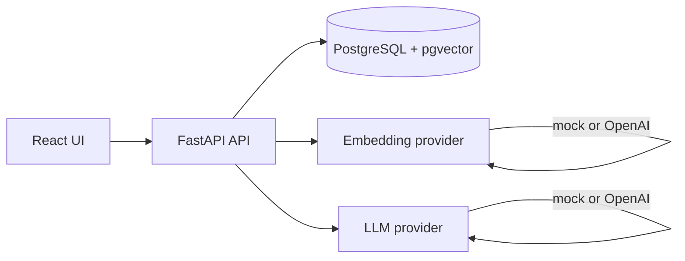

# Architecture — Mini Knowledge Assistant

## Overview

The system is a vertical slice: ingest plain-text articles, index chunk embeddings in Postgres, answer questions with retrieval-augmented generation, and return cited sources.

## Data model

| Table | Purpose |
| --- | --- |
| `documents` | Article metadata and full text (`id`, `title`, `content`, `created_at`) |
| `chunks` | Retrieval units with `chunk_index`, `text`, and `embedding vector(N)`; FK to `documents` with cascade delete |
| `questions` | Audit/history of asks (`question`, `answer`, `source_chunk_ids`, `latency_ms`, `created_at`) |

Chunks use an HNSW index with cosine distance (`vector_cosine_ops`).

## Service boundaries

- **API layer** (`app/api/*`): HTTP validation, rate limiting on `/ask`, maps errors to a stable JSON shape.
- **Persistence** (`app/db.py`, SQLAlchemy async): connection pooling, transactions for ingest and ask flows.
- **Chunking** (`services/chunking.py`): paragraph/sentence-aware splitting with overlap.
- **Embeddings** (`services/embeddings.py`): `EmbeddingProvider` with mock (hashed bag-of-words vectors, demo-only) and OpenAI-compatible HTTP client.
- **Retrieval** (`services/retrieval.py`): top-k cosine search via pgvector, minimum score threshold.
- **LLM** (`services/llm.py`): grounded generation with delimited context blocks; mock provider is extractive and labelled.
- **RAG orchestration** (`services/rag.py`): embed question → retrieve → generate (or short-circuit when nothing relevant).

Providers are injected through FastAPI dependencies so tests can override them without calling external APIs.

## Async behaviour

- Database: `asyncpg` + SQLAlchemy `AsyncSession`; handlers do not use blocking DB drivers.
- Upstream: shared `httpx.AsyncClient` pattern with explicit timeouts and async backoff sleeps.
- CPU work stays minimal (mock embeddings are lightweight); a local model would run in `run_in_executor`.

## Operational concerns

- **Config/secrets:** `pydantic-settings` from environment; no secrets in logs or responses.
- **Logging:** structured-ish JSON lines with `request_id`, method, path, status, latency.
- **Timeouts/retries:** bounded retries with exponential backoff + jitter on timeouts/5xx; upstream 429 is surfaced as 503 with `Retry-After` (no retry storm).
- **Monitoring (future):** metrics on ask latency, retrieval hit rate, LLM error rate, rate-limit hits, pool saturation.

## Failure behaviour

| Failure | User sees | Notes |
| --- | --- | --- |
| Invalid input | `422` + validation message | No internal details |
| Rate limit | `429` + `Retry-After` | Per IP or `X-API-Key` |
| DB down | `503` service unavailable | Logged server-side |
| LLM/embedding timeout | `504` | After retries exhausted |
| Upstream 5xx | `502` | After retries |
| Upstream 429 | `503` + `Retry-After` | Provider limit honoured |
| No relevant chunks | `200` safe “not found” answer | LLM not called |

## Rate limiting

In-memory sliding window (`RateLimiter` interface) keyed by `X-API-Key` or client IP — suitable for local/single instance. For horizontal scale, swap in Redis-backed implementation with the same interface.

## Scalability discussion

| Scale | First bottleneck | Evolution |
| --- | --- | --- |
| **10K concurrent** | LLM latency/quota, DB pool | Async I/O, timeouts, pool tuning, multiple workers, semaphore around LLM calls |
| **100K concurrent** | Single-node limits, in-memory rate limits | Load balancer, Redis rate limit + cache, queue ingestion, observability |
| **1M concurrent** | Provider quota, vector throughput | Split API vs workers, dedicated vector tier/replicas, multi-region, degradation (retrieval-only / cached answers) |

**Assumptions to measure:** p50/p95 LLM latency, tokens per request, corpus size, cache hit rate, read/write ratio, index recall vs latency, provider rate limits.

## Assumptions (this submission)

- Single tenant, no auth (client id = IP or optional API key header).
- Documents are plain text/markdown stored in Postgres.
- Mock mode is for demos only and is exposed via `/health` and response `mode`.
